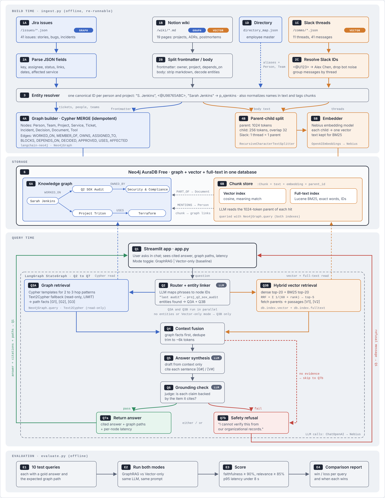

# GraphRAG for Organizational Knowledge

**Author:** Srikanth · **Track:** LangChain + LangGraph · **Repo:** https://github.com/srik4ds/graphrag-org-knowledge

## 1. Project overview
My RAG app helps engineering managers and tech leads answer multi-hop questions about people, projects, dependencies and decisions. It draws on Notion wiki pages, Jira issues and Slack threads, and answers in a Streamlit chat. The targets are 90% faithfulness, 85% relevance and under 8 seconds p95 latency.

Plain vector RAG fails on questions like "Who worked on the last compliance audit, and what tools do they use now?" because the answer spans several documents linked only by people and projects. GraphRAG stores those links in a knowledge graph and walks them with Cypher, while hybrid vector search covers the prose.

## 2. Datasets
Fintara is a synthetic fintech company:

| # | Source | Volume | Goes to |
|---|---|---|---|
| 1 | Employee directory (JSON) | 12 people, 5 teams | Graph, plus name lookup |
| 2 | Notion wiki (Markdown + YAML) | 19 pages: projects, services, ADRs, postmortems, runbook | Graph (frontmatter) and vector (body) |
| 3 | Jira (JSON) | 41 issues, including 3 incidents | Graph only |
| 4 | Slack (JSON) | 11 threads, 41 messages | Vector only |

**Result:** 118 nodes and 268 relationships in Neo4j AuraDB, plus 30 parent chunks and 35 child chunks with vector and full-text (BM25) indexes, all in the same database.

## 3. Architecture
1. **Ingestion:** cleaning (markdown strip, Slack `<@U123>` resolved to names), an entity resolver (one canonical id per person, so "S. Jenkins", "sjenkins" and "Sarah Jenkins" become one node), idempotent graph MERGE, parent-child chunking (1024/256 tokens, 32 overlap), and embeddings.
2. **Query (LangGraph):** a router LLM maps phrases to graph nodes. Graph retrieval (Cypher templates, with a read-only Text2Cypher fallback) and hybrid vector retrieval (dense + BM25 merged with RRF: `1/(60+dense_rank) + 1/(60+bm25_rank)`) run in parallel. Then come context fusion, cited answer synthesis, and an LLM grounding check that returns either the answer or a refusal.
3. **Baseline:** the same pipeline with the graph switched off, so any difference in results comes from the graph.
4. **UI:** Streamlit with GraphRAG, Vector-only and Compare-both modes, showing citations, Cypher, passages, grounding and per-node latency.

## 4. Prompts and agent instructions
All prompts live in `graphrag/agent/prompts.py`:

1. **Router:** extract entity mentions with label, category and temporal cue, then pick one of 9 Cypher templates. Returns JSON only.
2. **Synthesis:** answer only from the context, cite every sentence with [G#] or [V#], prefer graph facts for structured data, and reply INSUFFICIENT_CONTEXT if the answer isn't present.
3. **Grounding judge:** split the answer into claims and mark each one supported or unsupported against its citation.
4. **Text2Cypher:** read-only clauses only, return names rather than nodes, LIMIT 50.

## 5. Iterations
1. **Diagram v1:** grounding came before synthesis. Fixed in v2, because claims can't be checked before a draft exists.
2. **Stores:** moved from separate graph and vector DBs to Neo4j only (vector index plus full-text BM25 index), which also lets chunks link to graph nodes.
3. **Retrieval:** replaced pure dense search with hybrid dense + BM25 + RRF, so exact names and ticket ids are found.
4. **Entity resolver:** added because name variants were splitting one person into several nodes and breaking multi-hop paths.
5. **Offline mode:** Nebius credits were unavailable, so I added `LLM_PROVIDER=offline` (rule-based router, extractive answers, hashing embeddings). The graph side is unchanged, and the code switches back to Nebius or any OpenAI-compatible API through `.env`.
6. **Environment fixes:** moved to Python 3.11 for LangChain 1.x, and corrected the parsing of Aura's version string.

## 6. Evaluation results
Ten questions, each run in both modes with the same pipeline (vector-only = graph switched off). Full answers are in `results/eval_report_v1.md`.

**Run conditions:** offline mode (no LLM credits). Correctness and relevance are word-overlap scores against the gold answers, and answers are extractive.

### 6.1 Summary

| # | Metric | GraphRAG | Vector-only |
|---|---|---|---|
| 1 | Correctness (avg, 0-1) | **0.80** | 0.35 |
| 2 | Relevance (avg, 0-1) | **0.95** | 0.80 |
| 3 | Fact recall (avg, required facts found) | **0.815** | 0.393 |
| 4 | Faithfulness (claims supported) | 1.0 | 1.0 |
| 5 | Refusals | 0 | 0 |
| 6 | Latency p50 | 514 ms | 330 ms |
| 7 | Latency p95 | 1,149 ms | 355 ms |

**Scoreboard:** GraphRAG won 7 questions, 3 were ties, and Vector-only won none. Both modes stayed well under the 8-second p95 target.

### 6.2 Per question

| # | Id | Question type | GraphRAG | Vector | Winner | Why |
|---|---|---|---|---|---|---|
| 1 | Q01 | Last audit, then people, then next project, then tools | 1.0 | 0.5 | GraphRAG | Temporal "last" plus 3 hops; vector found the people but not the tools |
| 2 | Q02 | Latest incident, then service, then owner team, then API security ADRs | 1.0 | 0.5 | GraphRAG | Graph listed ADR-007 and ADR-009 for the Platform Team; vector surfaced ADR-008, which belongs to the wrong team |
| 3 | Q03 | If Alex leaves, which releases are at risk | 0.5 | 0.0 | GraphRAG | Graph traced both releases through 1-to-3-hop dependency chains |
| 4 | Q04 | Who approved ADR-005, and what it affects | 1.0 | 0.5 | GraphRAG | Graph gave approver and affected projects in one fact; vector mixed in approvals of other ADRs |
| 5 | Q05 | Open tickets blocking Triton GA | 1.0 | 0.0 | GraphRAG | Jira lives only in the graph; graph also excluded the closed TRI-8 |
| 6 | Q06 | Tools Linh used across projects | 1.0 | 0.5 | GraphRAG | 2-hop aggregation across projects |
| 7 | Q07 | Why Snowpipe Streaming over Kafka Connect | 1.0 | 1.0 | Tie | Rationale is prose; both used the same passages |
| 8 | Q08 | Root cause of the ledger-db outage | 0.0 | 0.0 | Tie | Offline hashing embeddings missed the root-cause paragraph |
| 9 | Q09 | SEV1 escalation process | 0.5 | 0.5 | Tie | Procedure is prose; partial recall in both modes |
| 10 | Q10 | Who has the most open Atlas tickets | 1.0 | 0.0 | GraphRAG | Counting needs structured data; vector cannot count tickets |

### 6.3 When each approach wins

| # | Question shape | Winner | Evidence |
|---|---|---|---|
| 1 | Multi-hop across entities (people, projects, services, teams) | GraphRAG | Q01, Q02, Q03, Q06 |
| 2 | Filtering and counting structured records (tickets, status) | GraphRAG | Q05, Q10 |
| 3 | "Who approved / what does it affect" | GraphRAG (cleaner) | Q04 |
| 4 | Why, how and root cause (prose) | Tie: the graph adds nothing, and the vector side does the work | Q07, Q08, Q09 |

### 6.4 Findings to fix next

1. **Q03 partial:** the graph returned TRI-12 as a fact, but the offline extractive answer keeps only the first 8 graph facts, so TRI-12 was cut. Fix: raise the cap and collapse duplicate dependency chains into one fact per release.
2. **Q08 miss:** offline hashing embeddings are weak on meaning. Fix: use a real embedding model (Nebius or Ollama).
3. **Faithfulness 1.0** is guaranteed by the extractive offline answers. It becomes a real measurement once an LLM writes the answers.

## 7. Learnings
1. GraphRAG wins when the answer is a path between entities. Vector RAG wins when the answer is a paragraph.
2. Entity resolution matters more than the model choice. One person split into three nodes breaks every multi-hop query.
3. Templates beat free-form Text2Cypher for reliability. The LLM only needs to pick a template and an entity.
4. Designing the refusal path (grounding check) first prevents confident wrong answers.
5. One Neo4j database for graph, vector and BM25 keeps the system simple and links text to entities.

**Limitations:** the demo and evaluation ran in offline mode (no LLM credits), so answers are extractive and scoring uses word overlap. Switching to Nebius or another OpenAI-compatible API only needs `.env` changes, followed by `python ingest.py --reset` and `python evaluate.py`.
